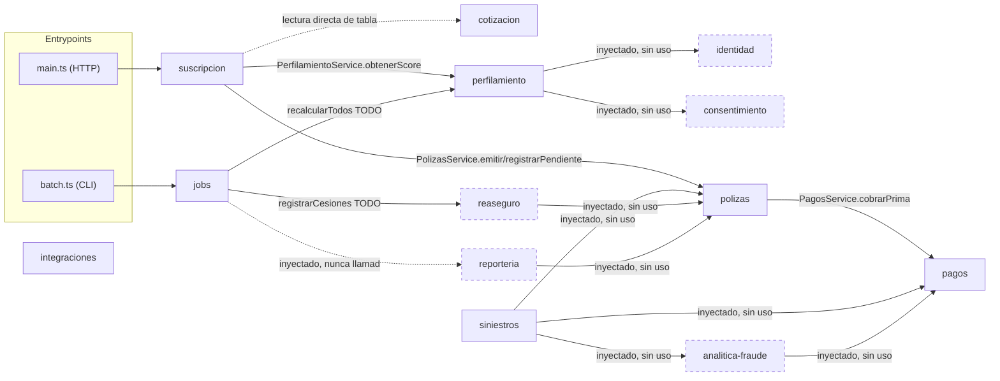

# PROYECTO.md — Estado actual del código (Solventa backend)

> Documento generado por lectura directa del código en el momento de escribirlo. Cada afirmación referencia la ruta del archivo entre backticks para poder verificarla. Donde el código es ambiguo o un comportamiento depende de una decisión futura, se marca **(por confirmar)**. No incluye nada que no esté en el repositorio.

---

## 1. Resumen general

### Stack y versiones (`package.json`)

- **Framework**: NestJS 12 (`@nestjs/common` `^12.0.1`, `@nestjs/core` `^12.0.1`, `@nestjs/platform-express` `^12.0.1`).
- **ORM / BD**: TypeORM `^1.1.1` + driver `pg` `^8.23.0`, contra PostgreSQL (16 en `docker-compose.yml`).
- **Config**: `@nestjs/config` `^12.0.0` (`ConfigModule.forRoot({ isGlobal: true })`).
- **Rate limiting**: `@nestjs/throttler` `^6.7.0` (configurado, no aplicado — ver §2.14).
- **Validación**: `class-validator` `^0.15.1`, `class-transformer` `^0.5.1`.
- **Runtime**: Node 22 (`node:22-alpine` en `Dockerfile`), TypeScript `^6.0.2`.
- **Tests**: Jest `^30.0.0` (unitarios) + Supertest `^7.0.0` (e2e, config en `test/jest-e2e.json`).
- **Lint/formato**: `oxlint` `^1.58.0` (`oxlint.json`), Prettier `^3.4.2` (`.prettierrc`).

### Entry points y ejecución

- **`src/main.ts`**: API HTTP. `NestFactory.create(AppModule)`, `ValidationPipe` global (`whitelist`, `forbidNonWhitelisted`, `transform` en `true`), escucha en `0.0.0.0:$PORT` (default 3000).
- **`src/batch.ts`**: proceso batch. `NestFactory.createApplicationContext(AppModule)` → obtiene `JobsService` → `ejecutarTodos()` → cierra el contexto. Se ejecuta con `npm run start:batch` (`node dist/batch`, requiere build previo).
- Scripts npm relevantes (`package.json`): `start:dev`, `start:debug`, `build`, `start:batch`, `migration:generate`/`migration:run` (contra `src/config/data-source.ts`), `lint`, `format`, `test`/`test:watch`/`test:cov`, `test:e2e`.
- **`docker-compose.yml`** (raíz): `solventa-db` (`postgres:16`, puerto 5432, volumen `solventa-db-data`), `api1`/`api2` (build desde `Dockerfile`, mismas env vars, `DB_SYNCHRONIZE` default `false`), `nginx` (`nginx:alpine`, puerto `8080`, balanceo round-robin entre `api1`/`api2` vía `nginx.conf`).
- **`.env.example`**: variables reconocidas por la app: `DB_HOST/PORT/USER/PASSWORD/NAME`, `DB_SYNCHRONIZE`, `DB_POOL_MAX`, `PORT`, `NODE_ENV`, `THROTTLE_TTL_MS`, `THROTTLE_LIMIT_POR_SOCIO`, `SUSCRIPCION_UMBRAL_APROBACION`, `SUSCRIPCION_UMBRAL_REVISION`.

### Módulos en `src/`

| Módulo | Responsabilidad (una línea) |
|---|---|
| `identidad` | Alta de clientes y credenciales/estado de verificación KYC. |
| `consentimiento` | Registro y consulta de consentimientos de datos (Open Finance-style). |
| `cotizacion` | Entidades de producto, socio de distribución y cotización; sin lógica de negocio propia todavía. |
| `perfilamiento` | Perfil de riesgo del cliente (score) y su exposición a `suscripcion`. |
| `suscripcion` | Decide aprobación/revisión/rechazo de una cotización y orquesta la emisión atómica. |
| `polizas` | Ciclo de vida de la póliza (emisión, pendiente, renovación, cancelación) con versión optimista. |
| `pagos` | Registro idempotente de cobros de prima e indemnizaciones. |
| `siniestros` | Reporte y gestión de siniestros (asistidos y paramétricos) y asignación de peritos. |
| `analitica-fraude` | Evaluación de fraude sobre siniestros y bloqueo de transacciones. |
| `reaseguro` | Cesiones de póliza a reaseguradoras. |
| `reporteria` | Generación y envío de reportes regulatorios/de cartera. |
| `integraciones` | Orquestador de llamadas a dependencias externas (timeout duro). |
| `jobs` | Orquestación de los procesos batch (`src/batch.ts`). |
| `common` | Transversal: guard de API key, transformer numérico. |
| `config` | `DataSource` standalone para la CLI de migraciones de TypeORM. |

Fuera de `suscripcion`, `polizas` y `pagos`, la mayoría de los métodos de servicio de los demás módulos son firmas con `throw new Error('No implementado')` precedidas de un comentario `// TODO(<modulo>): implementar por el dueño del modulo` — se detalla módulo por módulo en la §2 y se resume en la §8.

---

## 2. Ficha por módulo

### 2.1 `identidad`

**Entidades**

| Entidad / tabla | Columna | Tipo | PK | Nullable | Notas |
|---|---|---|---|---|---|
| `Cliente` / `clientes` (`src/identidad/entities/cliente.entity.ts`) | `id` | uuid | ✔ | no | `@PrimaryGeneratedColumn('uuid')` |
| | `nombre` | varchar | | no | |
| | `documentoIdentidad` | varchar | | no | `unique: true` |
| `IdentidadCredencial` / `identidad_credenciales` (`src/identidad/entities/identidad-credencial.entity.ts`) | `id` | uuid | ✔ | no | |
| | `clienteId` | uuid | | no | `unique: true` (0..1 credencial por cliente) |
| | `metodoKYC` | varchar | | no | |
| | `estadoVerificacion` | enum `EstadoVerificacionKYC` | | no | `pendiente` \| `verificado` \| `rechazado`, default `pendiente` |
| | `fechaVerificacion` | timestamptz | | sí | |

**Relaciones TypeORM**: ninguna (`clienteId` es uuid suelto, según la convención del proyecto).

**Referencias a otros módulos**: ninguna entrante en este módulo (es uno de los módulos base).

**Controller** (`src/identidad/identidad.controller.ts`): `@Controller('identidad')`, **sin endpoints** — comentario TODO pide definir `registrar`/`verificarKyc`.

**Service** (`src/identidad/identidad.service.ts`):
- `registrar(nombre, documentoIdentidad): Promise<Cliente>` — TODO, lanza `Error('No implementado')`.
- `verificarKyc(clienteId): Promise<IdentidadCredencial>` — TODO; el comentario indica que debe llamar al Orquestador (`src/integraciones`) con timeout duro de 700 ms (HU3.1.1).

**DTOs**: no hay (no hay controller con body que validar).

**Dependencias de módulo** (`identidad.module.ts`): solo `TypeOrmModule.forFeature([Cliente, IdentidadCredencial])`. No importa otros módulos de dominio. Exporta `IdentidadService`.

**Eventos**: no hay `EventEmitter`/bus en todo `src/` (verificado por búsqueda global, §4).

---

### 2.2 `consentimiento`

**Entidades**

| Entidad / tabla | Columna | Tipo | PK | Nullable | Notas |
|---|---|---|---|---|---|
| `Consentimiento` / `consentimientos` (`src/consentimiento/entities/consentimiento.entity.ts`) | `id` | uuid | ✔ | no | |
| | `fuente` | varchar | | no | ej. "open-finance" |
| | `alcance` | varchar | | no | scope autorizado |
| | `estado` | enum `EstadoConsentimiento` | | no | `activo` \| `revocado`, default `activo` |
| | `clienteId` | uuid | | no | sin `unique` (un cliente puede tener varios consentimientos) |

**Relaciones TypeORM**: ninguna.

**Referencias a otros módulos**: `clienteId` → `identidad.Cliente.id` (por convención de uuid suelto, sin FK declarada).

**Controller** (`src/consentimiento/consentimiento.controller.ts`): `@Controller('consentimientos')`, **sin endpoints** — TODO pide `otorgar`/`revocar`/`consultar`.

**Service** (`src/consentimiento/consentimiento.service.ts`):
- `tieneConsentimientoActivo(clienteId, alcance): Promise<boolean>` — **implementado**: `findOneBy({ clienteId, alcance, estado: ACTIVO })` y retorna si existe.
- `otorgar(clienteId, fuente, alcance)` — TODO, lanza error.
- `revocar(id)` — TODO (comentario: debe ser efectiva ≤5 min, HU3.2.1).
- `consultar(clienteId)` — TODO.

**Dependencias de módulo**: solo `TypeOrmModule.forFeature([Consentimiento])`. Exporta `ConsentimientoService`. Consumido por `perfilamiento` (inyectado, aún sin invocar en código real — ver §2.4).

**Eventos**: ninguno.

---

### 2.3 `cotizacion`

**Entidades**

| Entidad / tabla | Columna | Tipo | PK | Nullable | Notas |
|---|---|---|---|---|---|
| `Producto` / `productos` (`src/cotizacion/entities/producto.entity.ts`) | `id` | uuid | ✔ | no | |
| | `prima` | float | | no | prima base del producto |
| `SocioDistribucion` / `socios_distribucion` (`src/cotizacion/entities/socio-distribucion.entity.ts`) | `id` | uuid | ✔ | no | |
| | `canal` | varchar | | no | |
| | `apiKey` | varchar | | no | **sensible**, usada por `ApiKeyGuard` (§2.14) |
| `Cotizacion` / `cotizaciones` (`src/cotizacion/entities/cotizacion.entity.ts`) | `id` | uuid | ✔ | no | |
| | `prima` | float | | no | prima calculada de esta cotización |
| | `clienteId` | uuid | | no | |
| | `productoId` | uuid | | no | |
| | `socioDistribucionId` | uuid | | sí | |
| | `perfilRiesgoId` | uuid | | sí | agregado en este refactor, según `CLAUDE.md` |

**Relaciones TypeORM**: ninguna.

**Referencias a otros módulos**: `Cotizacion.clienteId` → `identidad.Cliente`; `Cotizacion.perfilRiesgoId` → `perfilamiento.PerfilRiesgo`. `productoId`/`socioDistribucionId` apuntan a entidades del propio módulo.

**Controller / Service**: **no existen** (`src/cotizacion/` solo tiene `entities/` y `cotizacion.module.ts`). No hay lógica de cotización, pricing ni caché de productos implementada.

**Módulo** (`src/cotizacion/cotizacion.module.ts`): registra las 3 entidades vía `TypeOrmModule.forFeature(...)` y hace `exports: [TypeOrmModule]` — esto expone los repositorios de `Cotizacion`/`Producto`/`SocioDistribucion` a quien importe el módulo (ver uso directo en `suscripcion`, §3).

**Eventos**: ninguno.

**(por confirmar)**: módulo pendiente de la rama `origin/feature/hu112-rolling-update-reglas-rating` (motor de reglas de rating), según `CLAUDE.md`; no verificable desde el código de esta rama.

---

### 2.4 `perfilamiento`

**Entidades**

| Entidad / tabla | Columna | Tipo | PK | Nullable | Notas |
|---|---|---|---|---|---|
| `PerfilRiesgo` / `perfiles_riesgo` (`src/perfilamiento/entities/perfil-riesgo.entity.ts`) | `id` | uuid | ✔ | no | |
| | `score` | float | | no | |
| | `señalesOpenFinance` | jsonb | | sí | |
| | `clienteId` | uuid | | no | `unique: true` (0..1 perfil por cliente) |

**Relaciones TypeORM**: ninguna.

**Referencias a otros módulos**: `clienteId` → `identidad.Cliente`.

**Controller** (`src/perfilamiento/perfilamiento.controller.ts`): sin endpoints (TODO).

**Service** (`src/perfilamiento/perfilamiento.service.ts`):
- `obtenerScore(perfilRiesgoId): Promise<number>` — **implementado**: `findOneByOrFail` + retorna `score`. Es el método que consume `suscripcion` (§2.5).
- `calcularPerfil(clienteId)` — TODO; el comentario indica que solo debe calcular si `consentimientoService.tieneConsentimientoActivo(...)` es `true` (fórmula de score sin definir).
- `recalcularTodos()` — TODO (HU4.3.1, job batch, ≥10M perfiles en <2h).

**Dependencias de módulo** (`perfilamiento.module.ts`): importa `IdentidadModule` y `ConsentimientoModule`; el constructor del service inyecta `IdentidadService` y `ConsentimientoService`, pero **ninguno de los dos se llama realmente en el código actual** — quedan listos para cuando se implemente `calcularPerfil`.

**Eventos**: ninguno.

---

### 2.5 `suscripcion`

**Entidades**

| Entidad / tabla | Columna | Tipo | PK | Nullable | Notas |
|---|---|---|---|---|---|
| `Suscripcion` / `suscripciones` (`src/suscripcion/entities/suscripcion.entity.ts`) | `id` | uuid | ✔ | no | |
| | `decision` | enum `DecisionSuscripcion` | | no | `aprobado` \| `revision_asistida` \| `rechazado`, sin default |
| | `cotizacionId` | uuid | | no | `unique: true` (garantiza idempotencia, HU2.3.1) |
| | `poliza` | relación | | sí | ver abajo |

**Relaciones TypeORM**: `@OneToOne(() => Poliza, p => p.suscripcion, { nullable: true }) @JoinColumn() poliza` — lado propietario; crea una columna FK implícita hacia `polizas` en la tabla `suscripciones`. Es la **única** relación `@OneToOne` del proyecto (excepción documentada en `CLAUDE.md` a la convención de uuid suelto).

**Referencias a otros módulos**: `cotizacionId` → `cotizacion.Cotizacion.id`.

**Controller** (`src/suscripcion/suscripcion.controller.ts`), `@Controller('suscripciones')`:
| Método | Ruta | Qué hace |
|---|---|---|
| `POST` | `/suscripciones` | `decidir(@Body() DecidirSuscripcionDto)`, responde `201 Created` con el resultado de `SuscripcionService.decidir()`. |
| `GET` | `/suscripciones/:id` | `buscar(id: uuid)`; si no existe, `404 NotFoundException`; si existe, devuelve el objeto. |

**DTO** (`src/suscripcion/dto/decidir-suscripcion.dto.ts`): `DecidirSuscripcionDto { cotizacionId: string }` con `@IsUUID()`. Combinado con el `ValidationPipe` global (`forbidNonWhitelisted`), cualquier campo extra en el body responde `400`.

**Service** (`src/suscripcion/suscripcion.service.ts`) — **implementado end-to-end**:
- `decidir(datos)`:
  1. Busca una `Suscripcion` existente por `cotizacionId` (con relación `poliza`); si existe, retorna `{ ...datos, idempotente: true }` sin crear nada.
  2. Carga la `Cotizacion`; si no existe, `404 NotFoundException`.
  3. Calcula `score` vía `perfilamientoService.obtenerScore(cotizacion.perfilRiesgoId)` si hay `perfilRiesgoId`, si no usa `0`.
  4. Decide `DecisionSuscripcion` comparando el score contra `SUSCRIPCION_UMBRAL_APROBACION`/`SUSCRIPCION_UMBRAL_REVISION` (env vars, defaults `0.7`/`0.4` — las consts `UMBRAL_APROBACION_POR_DEFECTO`/`UMBRAL_REVISION_POR_DEFECTO` del archivo).
  5. Abre `dataSource.transaction(...)`: guarda la `Suscripcion`; si `RECHAZADO` termina ahí; si `APROBADO` llama a `polizasService.emitir(manager, {...})`; si `REVISION_ASISTIDA` llama a `polizasService.registrarPendiente(manager, {...})`; en ambos casos enlaza la póliza resultante y vuelve a guardar la `Suscripcion`.
  6. Si la transacción falla con código Postgres `23505` (violación de unicidad, capturado **fuera** del callback de `dataSource.transaction`, porque TypeORM ya hizo rollback), relee la fila ganadora y retorna `idempotente: true`.
- `buscar(id): Promise<RespuestaSuscripcion | null>` — **implementado**, usado por el controller.
- Privados: `aRespuesta`, `evaluarUmbral`, `leerUmbral`.

**Dependencias de módulo** (`suscripcion.module.ts`): importa `PolizasModule`, `PerfilamientoModule`, `CotizacionModule`. Llamadas salientes reales: `PolizasService.emitir()`, `PolizasService.registrarPendiente()`, `PerfilamientoService.obtenerScore()`. Además inyecta `@InjectRepository(Cotizacion)` **directamente** (repositorio de otro módulo, habilitado porque `CotizacionModule` exporta `TypeOrmModule`) — ver nota de ownership en §3.

**Eventos**: ninguno.

---

### 2.6 `polizas`

**Entidades**

| Entidad / tabla | Columna | Tipo | PK | Nullable | Notas |
|---|---|---|---|---|---|
| `Poliza` / `polizas` (`src/polizas/entities/poliza.entity.ts`) | `id` | uuid | ✔ | no | |
| | `estado` | enum `EstadoPoliza` | | no | `pendiente` \| `emitida` \| `renovada` \| `cancelada`, default `pendiente` |
| | `clienteId` | uuid | | no | |
| | `productoId` | uuid | | no | |
| | `version` | int | | no | `@VersionColumn()` — incrementado por TypeORM en cada `save` |
| | `suscripcion` | relación | | — | lado inverso del `@OneToOne` (no declara `@JoinColumn`) |

`Poliza` **no tiene columna `prima`**: el monto cobrado viaja como parámetro (`cotizacion.prima`) en el DTO de emisión.

**Relaciones TypeORM**: `@OneToOne(() => Suscripcion, s => s.poliza) suscripcion` (lado inverso; el FK vive en `suscripciones`, ver §2.5).

**Referencias a otros módulos**: `clienteId` → `identidad.Cliente`; `productoId` → `cotizacion.Producto`.

**Controller**: **no existe** (`src/polizas/` no tiene `polizas.controller.ts`). No hay `GET /polizas/:id` ni rutas HTTP para `renovar`/`cancelar`.

**DTO** (`src/polizas/dto/emitir-poliza.dto.ts`): `EmitirPolizaDto { clienteId, productoId, monto }` — clase plana, **sin decoradores de `class-validator`** (no se expone por HTTP, solo se usa internamente entre services).

**Service** (`src/polizas/polizas.service.ts`) — **implementado**:
- `emitir(manager: EntityManager, datos: EmitirPolizaDto): Promise<Poliza>` — crea la `Poliza` en estado `EMITIDA` con el `manager` recibido (dentro de la transacción abierta por `suscripcion`), y a continuación llama a `pagosService.cobrarPrima(manager, poliza.id, datos.monto)` (el cobro ocurre **dentro** de `emitir`, cambio reciente según `git log`: commit `68d5f02`).
- `registrarPendiente(manager, { clienteId, productoId }): Promise<Poliza>` — crea la `Poliza` en estado `PENDIENTE`, sin cobrar nada.
- `renovar(id, version): Promise<Poliza>` — carga por `id`, compara `version` contra la recibida; si no coincide, `409 ConflictException`; si coincide, pasa a `RENOVADA` y guarda.
- `cancelar(id, version): Promise<Poliza>` — mismo patrón, pasa a `CANCELADA`.

**Dependencias de módulo** (`polizas.module.ts`): importa `PagosModule`; llama a `PagosService.cobrarPrima` desde `emitir()`.

**Eventos**: ninguno.

---

### 2.7 `pagos`

**Entidades**

| Entidad / tabla | Columna | Tipo | PK | Nullable | Notas |
|---|---|---|---|---|---|
| `Pago` / `pagos` (`src/pagos/entities/pago.entity.ts`) | `id` | uuid | ✔ | no | |
| | `tipo` | enum `TipoPago` | | no | `cobro_prima` \| `indemnizacion` |
| | `monto` | numeric + `numericTransformer` | | no | lee como `number`, no `string` (`src/common/transformers/numeric.transformer.ts`) |
| | `moneda` | varchar | | no | hardcodeada a `'USD'` en el service (TODO: definir por el dueño del módulo) |
| | `estado` | enum `EstadoPago` | | no | `pendiente` \| `bloqueado` \| `procesado` \| `fallido`, default `pendiente` |
| | `claveIdempotencia` | varchar | | no | `unique: true` |
| | `polizaId` | uuid | | sí | |
| | `siniestroId` | uuid | | sí | |
| | `fechaProcesado` | timestamptz | | sí | |

**Relaciones TypeORM**: ninguna.

**Referencias a otros módulos**: `polizaId` → `polizas.Poliza` (nullable); `siniestroId` → `siniestros.Siniestro` (nullable).

**Controller**: **no existe** (`src/pagos/` no tiene `pagos.controller.ts`; no hay rutas HTTP para pagos). **(por confirmar si está planeado)**.

**Service** (`src/pagos/pagos.service.ts`) — **implementado** (sin `@InjectRepository`; usa el `EntityManager` recibido como parámetro en cada llamada, no un repositorio propio inyectado):
- `cobrarPrima(manager, polizaId, monto): Promise<Pago>` — inserta con `claveIdempotencia = "prima:${polizaId}"`.
- `pagarIndemnizacion(manager, siniestroId, monto): Promise<Pago>` — inserta con `claveIdempotencia = "indem:${siniestroId}"`.
- `insertarIdempotente(...)` (privado) — `INSERT ... ON CONFLICT DO NOTHING` (`.orIgnore()`) y luego relee por `claveIdempotencia`; fuerza `moneda: 'USD'` y `estado: PENDIENTE`.
- **`procesar()`/`conciliar()` no existen ni como stubs** en el archivo actual — el único rastro es un comentario (`// TODO(pagos): procesar() y conciliar() ... se definen en el Paso 5`), a diferencia de otros módulos donde el método sí existe como firma que lanza error.

**Dependencias de módulo** (`pagos.module.ts`): solo `TypeOrmModule.forFeature([Pago])`. No importa ningún otro módulo (confirma la regla "pagos nunca importa polizas" de `CLAUDE.md`).

**Eventos**: ninguno.

---

### 2.8 `siniestros`

**Entidades** — herencia de tabla única (`@TableInheritance`, columna discriminadora `tipo`):

| Entidad / tabla | Columna | Tipo | PK | Nullable | Notas |
|---|---|---|---|---|---|
| `Siniestro` (abstracta) / `siniestros` (`src/siniestros/entities/siniestro.entity.ts`) | `id` | uuid | ✔ | no | |
| | `estado` | enum `EstadoSiniestro` | | no | `reportado` \| `enrutado_perito` \| `en_revision` \| `aprobado` \| `rechazado` \| `pagado`, default `reportado` |
| | `clienteId` | uuid | | no | |
| | `polizaId` | uuid | | no | |
| | `peritoId` | uuid | | sí | |
| | `fechaReporte` | timestamptz | | no | `@CreateDateColumn()` |
| | `fechaEnrutamiento` | timestamptz | | sí | |
| | `fechaPago` | timestamptz | | sí | |
| `SiniestroAsistido` (`@ChildEntity('asistido')`, `src/siniestros/entities/siniestro-asistido.entity.ts`) | — | — | — | — | sin columnas propias |
| `SiniestroParametrico` (`@ChildEntity('parametrico')`, `src/siniestros/entities/siniestro-parametrico.entity.ts`) | `datosEventoParametrico` | jsonb | | sí | datos del evento (sensor/umbral) |
| | `claveIdempotenciaPago` | varchar | | sí | `unique: true`; registra la clave del evento externo disparador (no es lo que garantiza unicidad del pago a nivel BD — eso lo hace `Pago.claveIdempotencia`) |
| `Perito` / `peritos` (`src/siniestros/entities/perito.entity.ts`) | `id` | uuid | ✔ | no | |
| | `nombre` | varchar | | no | |
| | `especialidad` | varchar | | no | |
| | `zona` | varchar | | no | |

**Relaciones TypeORM**: ninguna explícita entre `Siniestro` y `Perito` (uuid suelto `peritoId`).

**Referencias a otros módulos**: `clienteId` → `identidad.Cliente`; `polizaId` → `polizas.Poliza`.

**Controller** (`src/siniestros/siniestros.controller.ts`): `@Controller('siniestros')`, sin endpoints (TODO: `reportar`, `asignarPerito`, `aprobar`, `eventoParametrico`).

**Service** (`src/siniestros/siniestros.service.ts`) — **todos los métodos son TODO** (lanzan `Error('No implementado')`):
- `reportar(polizaId, clienteId)`.
- `asignarPerito(siniestroId, peritoId)` (comentario: asignación trazable 100 %).
- `aprobar(siniestroId)`.
- `eventoParametrico(siniestroId, datosEvento)` (comentario: HU6.2.1/6.2.2, debe usar `PagosService.pagarIndemnizacion` de forma idempotente).

El constructor inyecta `polizasService`, `pagosService` y `analiticaFraudeService`, pero **ninguno se usa todavía** porque los cuatro métodos públicos están sin implementar.

**Dependencias de módulo** (`siniestros.module.ts`): importa `PolizasModule`, `PagosModule`, `AnaliticaFraudeModule` — wiring listo, sin llamadas reales todavía.

**Eventos**: ninguno.

---

### 2.9 `analitica-fraude`

**Entidades**

| Entidad / tabla | Columna | Tipo | PK | Nullable | Notas |
|---|---|---|---|---|---|
| `MotorDeteccionFraude` / `motor_deteccion_fraude` (`src/analitica-fraude/entities/motor-deteccion-fraude.entity.ts`) | `id` | uuid | ✔ | no | |
| | `patronDetectado` | varchar | | no | valores válidos **sin definir** (TODO en el propio archivo) |
| | `nivelRiesgo` | varchar | | no | valores válidos sin definir |
| | `estado` | varchar | | no | valores válidos sin definir |
| | `siniestroId` | uuid | | no | |
| | `pagoId` | uuid | | sí | |

**Relaciones TypeORM**: ninguna.

**Referencias a otros módulos**: `siniestroId` → `siniestros.Siniestro`; `pagoId` → `pagos.Pago` (nullable).

**Controller**: sin endpoints (TODO: `evaluarSiniestro`, `bloquearTransaccion`).

**Service** (`src/analitica-fraude/analitica-fraude.service.ts`) — ambos métodos TODO:
- `evaluarSiniestro(siniestroId)` (comentario: debe responder en <1 s, HU6.3.1; regla de detección sin definir).
- `bloquearTransaccion(pagoId)` (comentario: bloqueo ≤1 s, HU6.3.1).

El constructor inyecta `pagosService`, sin uso actual.

**Dependencias de módulo**: importa `PagosModule`.

**Eventos**: ninguno.

---

### 2.10 `reaseguro`

**Entidades**

| Entidad / tabla | Columna | Tipo | PK | Nullable | Notas |
|---|---|---|---|---|---|
| `Reaseguradora` / `reaseguradoras` (`src/reaseguro/entities/reaseguradora.entity.ts`) | `id` | uuid | ✔ | no | |
| | `nombre` | varchar | | no | |
| | `codigo` | varchar | | no | `unique: true` |
| | `porcentajeCesion` | float | | no | |
| `CesionPoliza` / `cesiones_poliza` (`src/reaseguro/entities/cesion-poliza.entity.ts`, `@Unique(['polizaId','reaseguradoraId'])`) | `id` | uuid | ✔ | no | |
| | `polizaId` | uuid | | no | |
| | `reaseguradoraId` | uuid | | no | par único junto a `polizaId` |

**Relaciones TypeORM**: ninguna.

**Referencias a otros módulos**: `CesionPoliza.polizaId` → `polizas.Poliza`. `reaseguradoraId` apunta a la entidad propia del módulo.

**Controller**: sin endpoints (TODO).

**Service** (`src/reaseguro/reaseguro.service.ts`):
- `registrarCesiones(): Promise<void>` — TODO; el comentario aclara que las cesiones se generan **desde el batch**, no en la emisión de la póliza (decisión de diseño documentada en `CLAUDE.md`).

El constructor inyecta `polizasService`, sin uso actual (el método lanza error antes de llegar a usarlo).

**Dependencias de módulo**: importa `PolizasModule`.

**Eventos**: ninguno.

---

### 2.11 `reporteria`

**Entidades**

| Entidad / tabla | Columna | Tipo | PK | Nullable | Notas |
|---|---|---|---|---|---|
| `ReporteRegulatorio` / `reportes_regulatorios` (`src/reporteria/entities/reporte-regulatorio.entity.ts`) | `id` | uuid | ✔ | no | |
| | `destinatario` | varchar | | no | regulador o reaseguradora |
| | `periodoInicio` | date | | no | |
| | `periodoFin` | date | | no | |
| | `formato` | varchar | | no | ej. "ACORD" |
| | `estado` | enum `EstadoEnvioReporte` | | no | `pendiente` \| `enviado` \| `validado` \| `rechazado`, default `pendiente` |
| | `volumenRegistros` | int | | sí | |
| | `porcentajeExactitud` | float | | sí | |
| | `payload` | jsonb | | no | datos de cartera/siniestralidad enviados |

**Relaciones TypeORM**: ninguna.

**Referencias a otros módulos**: la entidad **no tiene** una columna uuid que apunte a `polizas` — el vínculo con pólizas específicas, si existe, viviría dentro del `payload` jsonb **(por confirmar, no es inspeccionable estáticamente)**.

**Controller**: sin endpoints (TODO: `generar`, `enviar`).

**Service** (`src/reporteria/reporteria.service.ts`):
- `generar(destinatario, periodoInicio, periodoFin)` — TODO (formato ACORD, HU8.3.1/HU8.3.2).
- `enviar(reporteId)` — TODO.

El constructor inyecta `polizasService`, sin uso actual.

**Dependencias de módulo**: importa `PolizasModule`.

**Eventos**: ninguno.

---

### 2.12 `integraciones`

**Entidades**: ninguna.

**Controller**: no existe.

**Service** (`src/integraciones/orquestador.service.ts`):
- `llamar<T>(dependencia: string, fn: () => Promise<T>, opciones?: { timeoutMs? }): Promise<T>` — **implementado**: ejecuta `fn()` contra un `Promise.race` con un timeout (`setTimeout` + `RequestTimeoutException`), default `700ms` (`TIMEOUT_MS_POR_DEFECTO`). Reintentos con backoff, caché de solo lectura y semáforo por dependencia: **TODO** (comentario explícito en el archivo).

**Dependencias de módulo** (`integraciones.module.ts`): sin imports de otros módulos; `providers`/`exports`: `OrquestadorService`.

**Uso real verificado**: `IntegracionesModule` solo se importa desde `app.module.ts`; **ningún otro módulo importa `IntegracionesModule` ni inyecta `OrquestadorService`** (verificado por búsqueda global). El método `llamar()` existe pero hoy **no lo invoca ningún service** del repositorio.

**Mocks de proveedores externos (KYC, Open Finance, pasarela, regulador)**: **no existen** archivos de cliente/adaptador para ninguno de ellos (verificado por búsqueda; coincide con lo declarado en `CLAUDE.md`).

**Eventos**: ninguno.

---

### 2.13 `jobs`

**Entidades**: ninguna. **Controller**: no existe (solo se dispara desde `src/batch.ts`).

**Service** (`src/jobs/jobs.service.ts`):
- `recalcularPerfiles(): Promise<void>` — llama a `perfilamientoService.recalcularTodos()` (que hoy lanza error porque es TODO, §2.4).
- `generarCesionesReaseguro(): Promise<void>` — llama a `reaseguroService.registrarCesiones()` (TODO, §2.10).
- `generarReportesPeriodicos(): Promise<void>` — lanza `Error('No implementado')` **directamente**, sin llamar a `reporteriaService` (que sí está inyectado en el constructor pero queda **sin usar**: el comentario indica que faltan definir los parámetros de periodo/destinatario antes de poder llamarlo).
- `ejecutarTodos(): Promise<void>` — ejecuta los tres jobs en secuencia envueltos en `ejecutarJob()`, que hace `try/catch` alrededor de cada uno: loguea inicio/fin con `Logger`, y si el job lanza error, **lo captura y solo lo loguea** (no relanza). Consecuencia: `src/batch.ts` siempre termina con éxito (`await jobsService.ejecutarTodos()` nunca rechaza), aunque los tres jobs fallen por ser TODO.

**Dependencias de módulo** (`jobs.module.ts`): importa `PerfilamientoModule`, `ReaseguroModule`, `ReporteriaModule`.

**Disparo**: únicamente `src/batch.ts` (proceso aparte, `npm run start:batch`). No hay `@Cron()` ni `setInterval` en el repositorio — nada programa `ejecutarTodos()` dentro del proceso HTTP (verificado por búsqueda global de `Cron`/`EventEmitter`/colas, sin resultados).

**Eventos**: ninguno.

---

### 2.14 Plataforma / común (no es un módulo Nest por sí mismo)

- **`ApiKeyGuard`** (`src/common/guards/api-key.guard.ts`): `CanActivate`; lee la cabecera `x-api-key`, busca un `SocioDistribucion` por `apiKey` (inyecta `@InjectRepository(SocioDistribucion)`, repositorio de la entidad del módulo `cotizacion`), y si existe la adjunta como `request.socioDistribucion`; si no hay cabecera o no matchea, `401 UnauthorizedException`. **No está registrado como provider en ningún `@Module`, ni aplicado con `@UseGuards(ApiKeyGuard)` en ningún controller** (verificado: solo aparece declarado en su propio archivo). Hoy es código muerto desde el punto de vista de wiring — existe pero Nest nunca lo instancia en una request real.
- **`ThrottlerModule.forRoot(...)`** (`src/app.module.ts`): configurado globalmente con `ttl`/`limit` desde `THROTTLE_TTL_MS`/`THROTTLE_LIMIT_POR_SOCIO`, pero **no hay `@UseGuards(ThrottlerGuard)` ni provider `APP_GUARD` en ningún archivo** — el guard de throttling nunca se activa sobre ninguna ruta (verificado por búsqueda global). Tampoco existe ninguna subclase que sobreescriba `getTracker()` para limitar por `socioDistribucion.id` en vez de por IP.
- **`numericTransformer`** (`src/common/transformers/numeric.transformer.ts`): convierte `numeric` (string en Postgres) ↔ `number` en JS; usado por `Pago.monto`.
- **`src/config/data-source.ts`**: `DataSource` standalone para la CLI de migraciones (`migration:generate`/`migration:run`), con `entities: ['src/**/*.entity.ts']` y `migrations: ['src/migrations/*.ts']`. **La carpeta `src/migrations/` no existe** en el repositorio (verificado por `Glob`) — no hay ninguna migración generada todavía; el único mecanismo de creación de esquema hoy es `DB_SYNCHRONIZE=true`.

---

## 3. Mapa de datos (vista de información)

| Módulo | Tablas propias | Tablas de otros módulos que referencia por UUID |
|---|---|---|
| `identidad` | `clientes`, `identidad_credenciales` | — |
| `consentimiento` | `consentimientos` | `clientes` (`clienteId`, sin FK declarada) |
| `cotizacion` | `productos`, `socios_distribucion`, `cotizaciones` | `clientes` (`Cotizacion.clienteId`), `perfiles_riesgo` (`Cotizacion.perfilRiesgoId`) |
| `perfilamiento` | `perfiles_riesgo` | `clientes` (`clienteId`) |
| `suscripcion` | `suscripciones` | `cotizaciones` (`cotizacionId`); `polizas` vía el `@OneToOne` propietario (`poliza`) |
| `polizas` | `polizas` | `clientes` (`clienteId`), `productos` (`productoId`) |
| `pagos` | `pagos` | `polizas` (`polizaId`, nullable), `siniestros` (`siniestroId`, nullable) |
| `siniestros` | `siniestros` (+ discriminador `asistido`/`parametrico`), `peritos` | `clientes` (`clienteId`), `polizas` (`polizaId`) |
| `analitica-fraude` | `motor_deteccion_fraude` | `siniestros` (`siniestroId`), `pagos` (`pagoId`, nullable) |
| `reaseguro` | `reaseguradoras`, `cesiones_poliza` | `polizas` (`CesionPoliza.polizaId`) |
| `reporteria` | `reportes_regulatorios` | ninguna columna uuid propia (posible referencia solo dentro de `payload` jsonb, **por confirmar**) |
| `integraciones` | — | — |
| `jobs` | — | — |

### Violaciones de ownership (lectura/escritura directa de tablas de otro módulo)

Se buscaron todos los `@InjectRepository(...)` del código (`src/`) y se cruzaron contra el módulo dueño de cada entidad. Hay exactamente **dos** casos donde un componente inyecta el repositorio de una entidad que no es suya:

1. **`SuscripcionService`** (`src/suscripcion/suscripcion.service.ts:29`) inyecta `@InjectRepository(Cotizacion)` — entidad propiedad de `cotizacion`. Está habilitado deliberadamente: `cotizacion.module.ts` hace `exports: [TypeOrmModule]` (en vez de exportar un service, porque `cotizacion` no tiene uno) precisamente para que `suscripcion` pueda leer `Cotizacion` directamente. No es una violación accidental, pero sí es lectura directa de tabla ajena (sin pasar por un service de `cotizacion`, porque ese service no existe).
2. **`ApiKeyGuard`** (`src/common/guards/api-key.guard.ts:19`) inyecta `@InjectRepository(SocioDistribucion)` — entidad también de `cotizacion`, por el mismo `exports: [TypeOrmModule]`. Mismo patrón; hoy irrelevante en producción porque el guard no está wireado a ningún controller (§2.14).

Ningún otro service inyecta un repositorio fuera de su propio módulo (verificado listando los 15 `@InjectRepository(...)` del repositorio).

---

## 4. Comunicación entre módulos

Todas las interacciones encontradas en el código son **llamadas síncronas en memoria** (inyección de un service de otro módulo o lectura de su repositorio vía TypeORM). **No existe ningún bus de eventos, cola, `EventEmitter2`, `@OnEvent`, `@Cron` ni cliente de mensajería** en `src/` (búsqueda global sin resultados) — todas las líneas del diagrama siguiente son continuas.

| Origen | Destino | Tipo | Método/acceso | Estado |
|---|---|---|---|---|
| `suscripcion` | `polizas` | llamada a service | `PolizasService.emitir()` / `registrarPendiente()` | **Implementada** |
| `suscripcion` | `perfilamiento` | llamada a service | `PerfilamientoService.obtenerScore()` | **Implementada** |
| `suscripcion` | `cotizacion` | lectura directa de repositorio | `@InjectRepository(Cotizacion)` | **Implementada** (no es una llamada a service, ver §3) |
| `polizas` | `pagos` | llamada a service | `PagosService.cobrarPrima()` (desde dentro de `emitir()`) | **Implementada** |
| `perfilamiento` | `identidad` | llamada a service (inyectada) | `IdentidadService` | Inyectada, **sin uso** (ningún método la llama hoy) |
| `perfilamiento` | `consentimiento` | llamada a service (inyectada) | `ConsentimientoService.tieneConsentimientoActivo()` | Inyectada, **sin uso** (referenciada solo en el comentario TODO de `calcularPerfil`) |
| `siniestros` | `polizas` | llamada a service (inyectada) | `PolizasService` | Inyectada, **sin uso** (los 4 métodos de `SiniestrosService` son TODO) |
| `siniestros` | `pagos` | llamada a service (inyectada) | `PagosService` | Inyectada, **sin uso** |
| `siniestros` | `analitica-fraude` | llamada a service (inyectada) | `AnaliticaFraudeService` | Inyectada, **sin uso** |
| `analitica-fraude` | `pagos` | llamada a service (inyectada) | `PagosService` | Inyectada, **sin uso** |
| `reaseguro` | `polizas` | llamada a service (inyectada) | `PolizasService` | Inyectada, **sin uso** (`registrarCesiones` es TODO) |
| `reporteria` | `polizas` | llamada a service (inyectada) | `PolizasService` | Inyectada, **sin uso** |
| `jobs` | `perfilamiento` | llamada a service | `PerfilamientoService.recalcularTodos()` | Llamada real, pero el destino lanza error (TODO) |
| `jobs` | `reaseguro` | llamada a service | `ReaseguroService.registrarCesiones()` | Llamada real, destino TODO |
| `jobs` | `reporteria` | — | `ReporteriaService` inyectado en `JobsService` pero **nunca invocado** — `generarReportesPeriodicos()` lanza error sin tocarlo | Inyectada, **sin uso ni siquiera para fallar** |
| `batch.ts` | `jobs` | entry point → service | `JobsService.ejecutarTodos()` | **Implementada** (orquestación; los 3 jobs internos son TODO) |
| (ninguno) | `integraciones` | — | `OrquestadorService` solo provisto en `AppModule`; **ningún módulo lo importa ni lo llama** | Implementado, **completamente sin wireo** |

### Diagrama (Mermaid)

Leyenda: línea continua con etiqueta = llamada síncrona entre services (implementada o solo wireada, según la etiqueta); línea punteada = lectura directa de repositorio ajeno o dependencia inyectada que ningún método llega a invocar. No se dibujan líneas de evento/async porque no existe ningún mecanismo de ese tipo en el código (ver arriba).

---

## 5. Procesos batch y jobs

- **Disparo único**: `npm run start:batch` → `node dist/batch` → `src/batch.ts` → `JobsService.ejecutarTodos()`. No hay scheduler (`@Cron`, `setInterval`, cola) dentro del proceso HTTP; es un proceso aparte que hay que invocar manualmente o desde un orquestador externo (cron del sistema, step function, etc. — **no documentado en el código**).
- **`recalcularPerfiles()`** (`src/jobs/jobs.service.ts`) → `PerfilamientoService.recalcularTodos()`: **TODO**, no toca ninguna tabla hoy (lanza error antes de hacer cualquier query). Pensado para HU4.3.1 (recálculo de `perfiles_riesgo` a escala).
- **`generarCesionesReaseguro()`** → `ReaseguroService.registrarCesiones()`: **TODO**, no toca ninguna tabla hoy. Pensado para poblar `cesiones_poliza` a partir de `polizas` + `reaseguradoras`, por diseño explícito (las cesiones no se crean al emitir la póliza).
- **`generarReportesPeriodicos()`**: **TODO**, lanza error directamente sin siquiera intentar tocar `reportes_regulatorios`.
- Los tres jobs corren secuencialmente dentro de `ejecutarTodos()`, cada uno con `try/catch` individual que solo loguea el fallo (`Logger.error`) sin relanzar — el proceso batch siempre sale con código de éxito aunque todo falle.

---

## 6. Integraciones externas

- **Framework genérico**: `OrquestadorService.llamar<T>(dependencia, fn, opciones?)` (`src/integraciones/orquestador.service.ts`) — único punto de abstracción para llamadas externas. Implementa **timeout duro** vía `Promise.race` contra un `setTimeout` (`RequestTimeoutException`), configurable por llamada (`opciones.timeoutMs`), default `700 ms`.
- **No implementado todavía dentro del Orquestador**: reintentos con backoff, caché de solo lectura como fallback, semáforo por dependencia con límite configurable por env var (comentario explícito en el archivo).
- **Clientes/mocks de proveedores concretos**: **no existen** — no hay ningún archivo para KYC, Open Finance, pasarela de pagos ni regulador. Los únicos lugares donde el código *menciona* que deberían llamar al Orquestador son comentarios TODO en `IdentidadService.verificarKyc` (HU3.1.1, 700 ms) — pero hoy ese método ni siquiera importa `OrquestadorService`.
- **Wiring**: `IntegracionesModule` solo está importado en `app.module.ts`; ningún otro módulo lo importa, por lo que `OrquestadorService` no es inyectable fuera de providers que vivan directamente en `AppModule` (que tampoco lo inyecta). En la práctica, el Orquestador existe pero está desconectado de cualquier flujo real.

---

## 7. Infraestructura y pruebas

### Docker Compose

| Archivo | Servicios | Puertos | Volúmenes |
|---|---|---|---|
| `docker-compose.yml` (raíz) | `solventa-db` (postgres:16), `api1`/`api2` (build local, mismo `&api` anchor), `nginx` (nginx:alpine) | `5432` (db), `8080` (nginx, único puerto expuesto al host) | `solventa-db-data` |
| `experimento/docker/docker-compose.db.yml` | `db` (postgres:16, `max_connections=200`, `shared_buffers=512MB`) | `5432` | `pgdata` |
| `experimento/docker/docker-compose.app.yml` | `api` (build desde `../../Dockerfile`, `env_file: ../.env.experimento`) | `3000` | — |

`nginx.conf`: proxy reverso simple, `upstream solventa_api { server api1:3000; server api2:3000; }`, balanceo round-robin por defecto de Nginx (sin configuración explícita de algoritmo).

### Scripts SQL / seed

- **`experimento/seed/reset-y-semilla.sql`**: recibe `n` como variable `psql` (`-v n=...`). `TRUNCATE ... RESTART IDENTITY CASCADE` sobre `suscripciones, pagos, polizas, cotizaciones, perfiles_riesgo, consentimientos, identidad_credenciales, clientes, productos` (líneas 13-15). Inserta: 20 `productos` fijos (prima aleatoria entre 50.000 y 500.000, líneas 18-20); `n` filas en `clientes`, `identidad_credenciales` (KYC ya verificado), `consentimientos` (ya activos) y `perfiles_riesgo` — este último reparte los scores en 70 % `[0.70,1.00)` aprobación, 20 % `[0.40,0.70)` revisión, 10 % `[0.00,0.40)` rechazo (líneas 37-47); y `n` filas en `cotizaciones` (una por cliente, prima ajustada por el score, líneas 49-57). Exporta `cotizaciones.csv` (columnas `id`, `esperado` ∈ `aprobada`/`revision`/`rechazada`) vía `\copy` (línea 64).
- **`experimento/.env.experimento` / `.env.experimento.example`**: configuración de BD y umbrales para levantar la API del experimento vía Docker con `DB_SYNCHRONIZE=true`.

### Pruebas de carga (k6)

- **`experimento/scripts/correr-escalera.sh`**: corre una "escalera" de 7 niveles (`smoke`, `carga-baja`, `carga-media`, `operacion-normal`, `carga-alta`, `carga-muy-alta`, `estres`), cada uno con su TPS/duración/repeticiones (líneas 23-31). Antes de cada repetición, re-siembra la BD con `n = tps*segundos*1.2 + 100` (línea 40), verifica `/health`, espera un enfriamiento (`ENFRIAMIENTO`, default 60 s) y corre `k6 run .../suscripcion.js`.
- **`experimento/k6/suscripcion.js`**: único endpoint probado es `POST /suscripciones` (una cotización nueva por iteración, tomada de `cotizaciones.csv`). Umbrales del ASR de HU2.1.1: `latencia_aprobada` p95<1500 ms / p99<3000 ms, `tasa_error`<1 %.

### Pruebas unitarias / e2e

- Unitarias (`npm run test`): **solo existe** `src/app.controller.spec.ts` (verifica `AppController.getHello()`). Ningún módulo de dominio tiene `*.spec.ts` propio.
- E2E (`npm run test:e2e`, `test/jest-e2e.json`): **solo existe** `test/app.e2e-spec.ts`, que levanta `AppModule` completo y verifica `GET /` → `200 "Hello World!"`. No hay e2e para `POST /suscripciones` ni para ningún otro endpoint de dominio.

---

## 8. Pendientes y observaciones

### TODOs explícitos en el código (por archivo)

- `src/identidad/identidad.service.ts` — `registrar`, `verificarKyc` (debería usar el Orquestador con timeout 700 ms, HU3.1.1).
- `src/identidad/identidad.controller.ts` — sin endpoints definidos.
- `src/consentimiento/consentimiento.service.ts` — `otorgar`, `revocar` (≤5 min, HU3.2.1), `consultar`.
- `src/consentimiento/consentimiento.controller.ts` — sin endpoints.
- `src/perfilamiento/perfilamiento.service.ts` — `calcularPerfil` (fórmula de score sin definir), `recalcularTodos` (HU4.3.1).
- `src/perfilamiento/perfilamiento.controller.ts` — sin endpoints.
- `src/siniestros/siniestros.service.ts` — `reportar`, `asignarPerito`, `aprobar`, `eventoParametrico`.
- `src/siniestros/siniestros.controller.ts` — sin endpoints.
- `src/analitica-fraude/analitica-fraude.service.ts` — `evaluarSiniestro` (<1 s), `bloquearTransaccion` (≤1 s).
- `src/analitica-fraude/entities/motor-deteccion-fraude.entity.ts` — valores válidos de `patronDetectado`/`nivelRiesgo`/`estado` sin definir.
- `src/reaseguro/reaseguro.service.ts` — `registrarCesiones` (diseñado para correr desde el batch).
- `src/reporteria/reporteria.service.ts` — `generar` (formato ACORD), `enviar`.
- `src/integraciones/orquestador.service.ts` — reintentos con backoff, caché de solo lectura, semáforo por dependencia.
- `src/pagos/pagos.service.ts` — comentario sobre `procesar()`/`conciliar()` ("se definen en el Paso 5"), pero **no hay ni siquiera firmas stub** para esos dos métodos en el archivo actual.
- `src/common/guards/api-key.guard.ts` y `src/app.module.ts` (líneas 37-42) — `ApiKeyGuard`/`ThrottlerGuard` sin aplicar a ningún controller; falta personalizar `getTracker()` para limitar por `socioDistribucion.id`.
- `src/jobs/jobs.service.ts` — `generarReportesPeriodicos` TODO; comentarios recuerdan que `recalcularPerfiles`/`generarCesionesReaseguro` dependen de TODOs de otros módulos.

### Módulos vacíos o incompletos (más allá de los TODOs de arriba)

- **`cotizacion`**: no tiene `service` ni `controller`; es solo `entities/` + `cotizacion.module.ts`. Toda la lógica de pricing/rating queda fuera de esta rama (coincide con lo declarado en `CLAUDE.md` sobre `origin/feature/hu112-rolling-update-reglas-rating`).
- **`polizas`**: no tiene `controller` (no hay `GET /polizas/:id`, ni rutas HTTP para `renovar`/`cancelar`, aunque el service sí las implementa).
- **`pagos`**: no tiene `controller`; además `procesar()`/`conciliar()` no existen ni como stubs.
- **`identidad`, `consentimiento`, `perfilamiento`, `siniestros`, `analitica-fraude`, `reaseguro`, `reporteria`**: controllers declarados pero sin ningún endpoint (`@Controller(...)` vacío).
- **`integraciones`**: implementado pero huérfano — ningún otro módulo lo importa ni invoca `OrquestadorService.llamar()`.
- **`ApiKeyGuard`**: clase completa pero no registrada/aplicada en ningún lado.
- **`ThrottlerModule`**: configurado globalmente pero sin guard aplicado en ninguna ruta.
- **Migraciones**: `src/migrations/` no existe; todo el esquema depende de `synchronize`.

### Inconsistencias/observaciones notables

- `JobsService` inyecta `ReporteriaService` en el constructor pero `generarReportesPeriodicos()` nunca lo usa — es una dependencia inyectada y completamente ignorada incluso en el camino que debería llamarla.
- El cobro de la prima se movió recientemente (según `git log`, commit `68d5f02`) de `suscripcion` hacia dentro de `PolizasService.emitir()`; los archivos `src/polizas/polizas.service.ts` y `src/suscripcion/suscripcion.service.ts` aparecen como modificados sin commitear en el estado actual del working tree (`git status`), reflejando ese mismo refactor en curso.
- `SuscripcionService` y `ApiKeyGuard` leen el repositorio de `Cotizacion`/`SocioDistribucion` directamente en vez de a través de un service de `cotizacion`, porque ese módulo no expone ningún service — es una excepción deliberada al ownership estricto, habilitada por `cotizacion.module.ts: exports: [TypeOrmModule]` (ver §3).
- No hay ningún mecanismo de eventos de negocio (HU10.4.1/HU10.4.2 de `CLAUDE.md`) implementado en el código: todo el acoplamiento entre módulos es síncrono e in-process.

---

*(Fin del documento. Generado por lectura de código; no modifica ningún otro archivo del repositorio.)*
